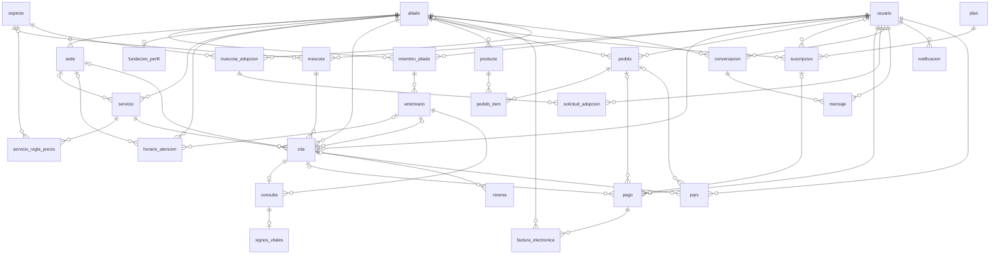
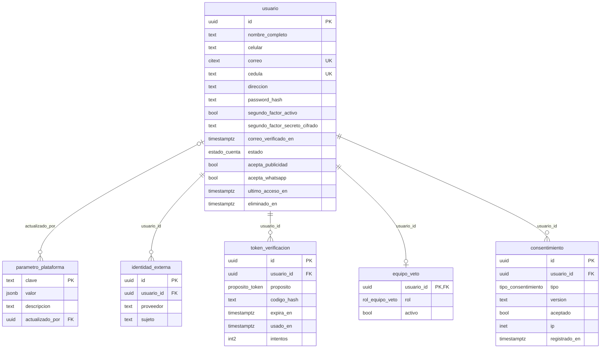
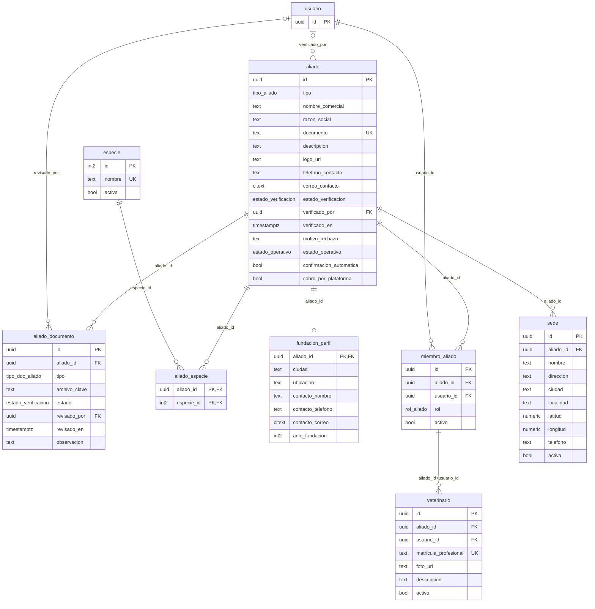
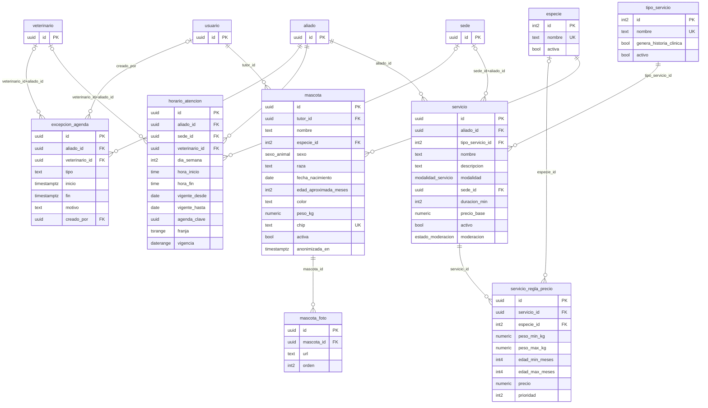
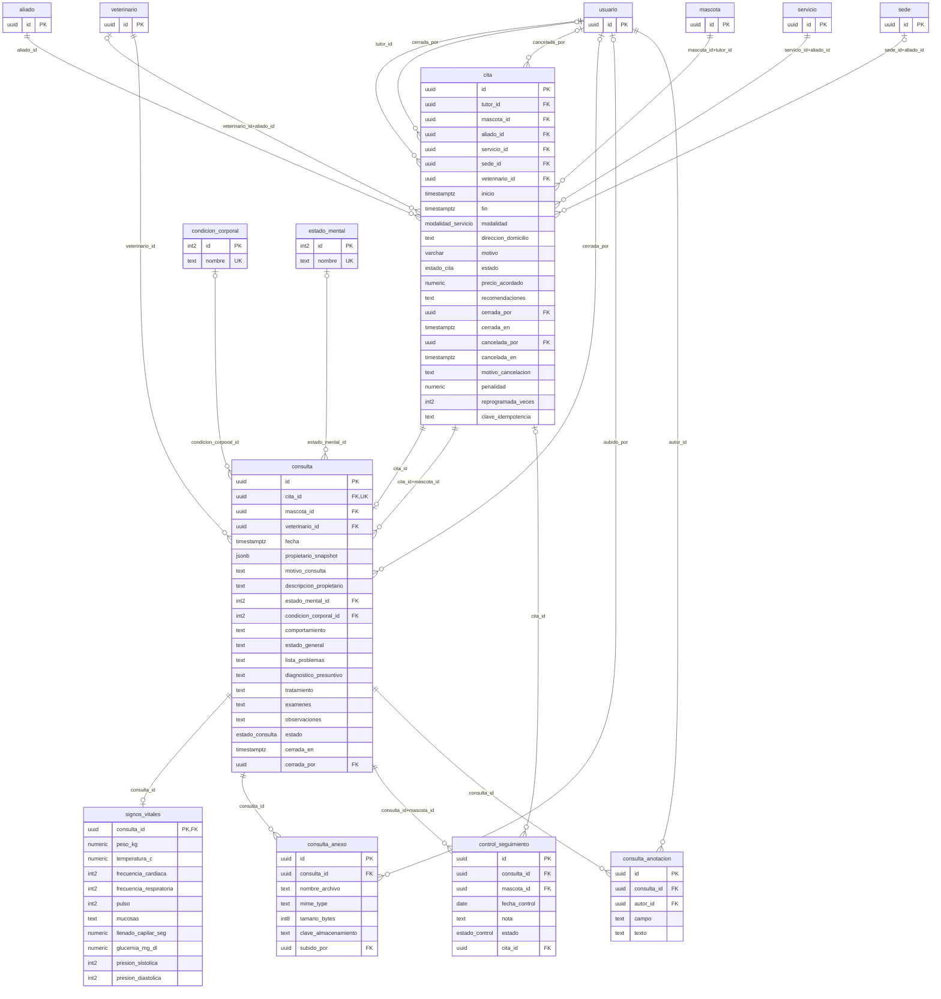
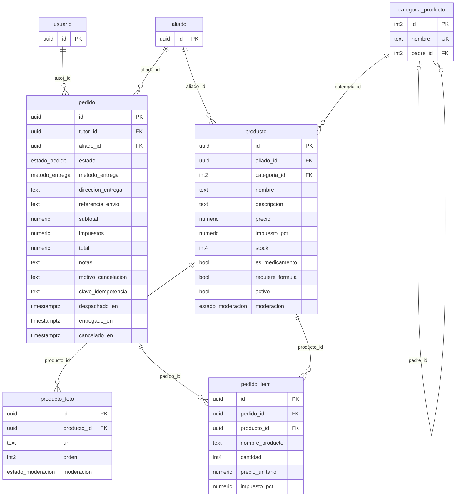
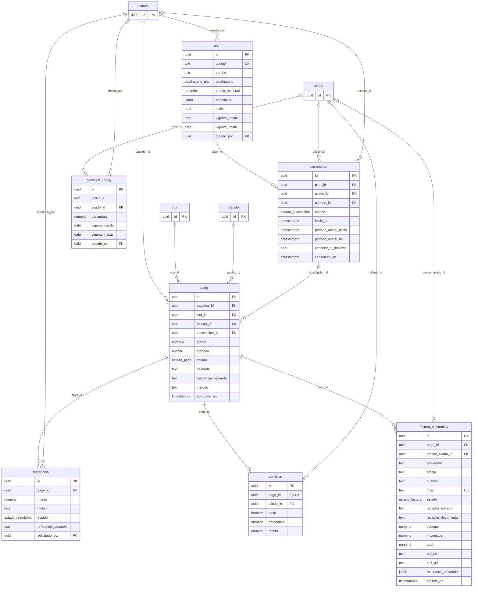
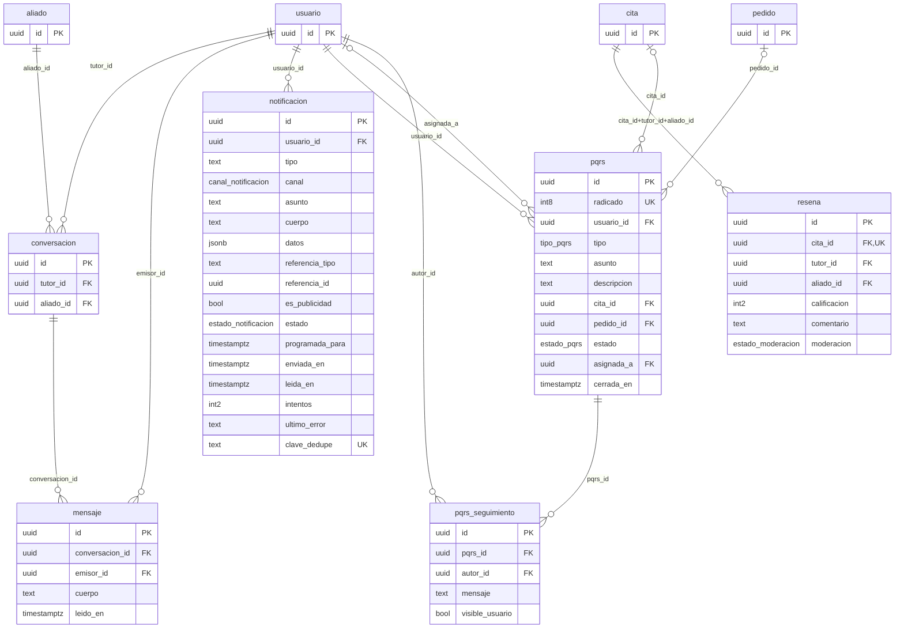
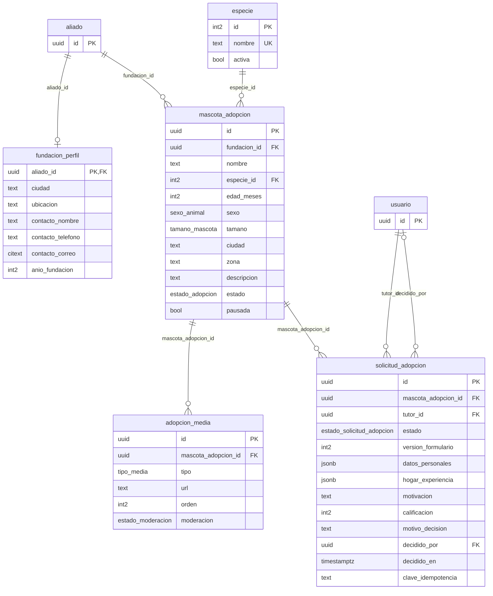
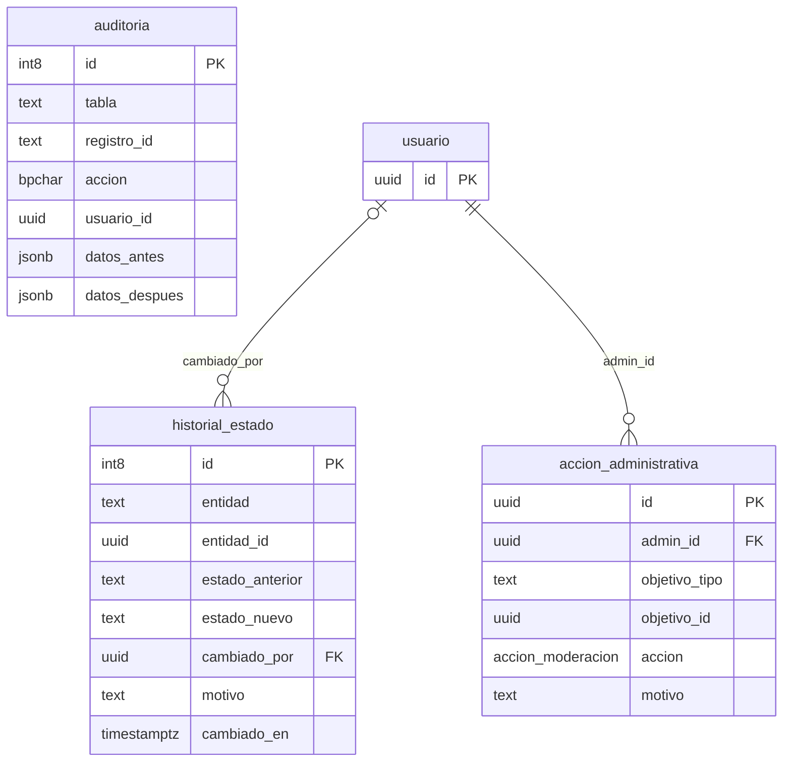

### Vista general (entidades principales, sin columnas)

### 1 · Cuentas y acceso

### 2 · Aliados, sedes y veterinarios

### 3 · Mascotas, servicios y disponibilidad

### 4 · Citas e historia clínica

### 5 · Productos y pedidos

### 6 · Planes, suscripciones, pagos y facturación

### 7 · Reseñas, chat, notificaciones y PQRS

### 8 · Adopción

### 9 · Administración y auditoría

