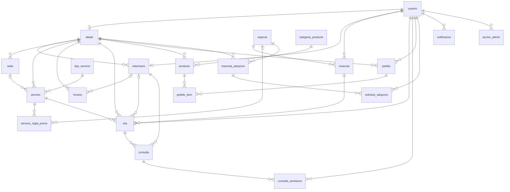
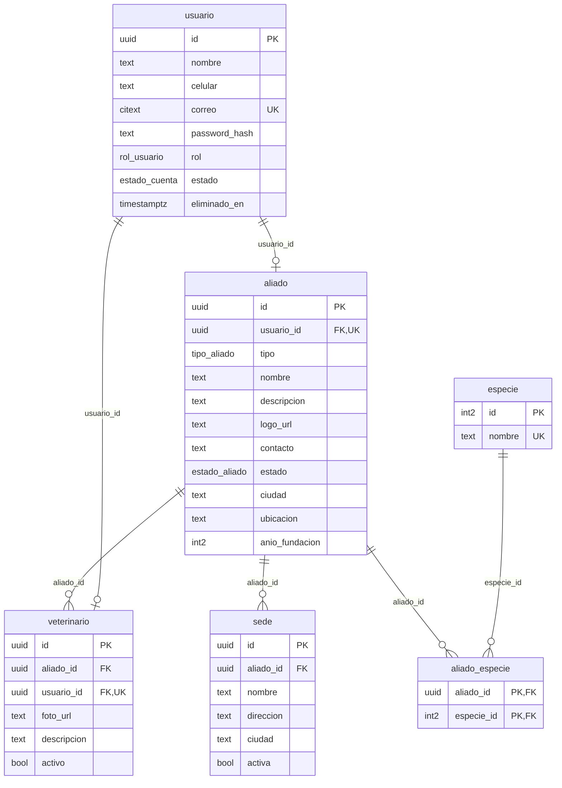
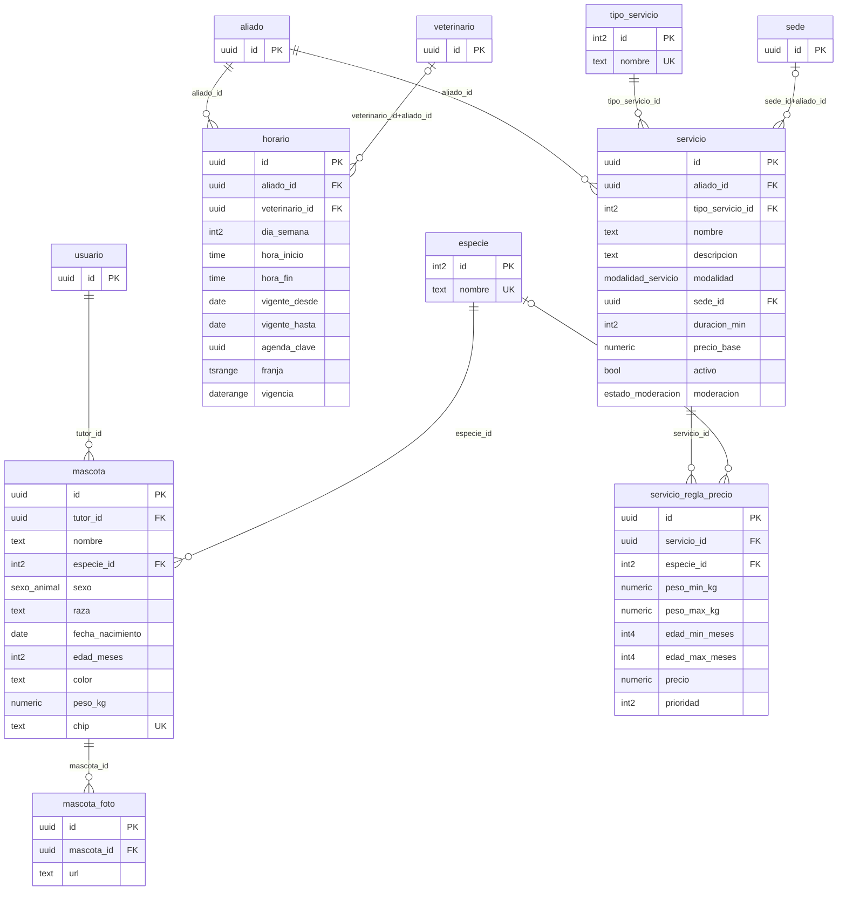
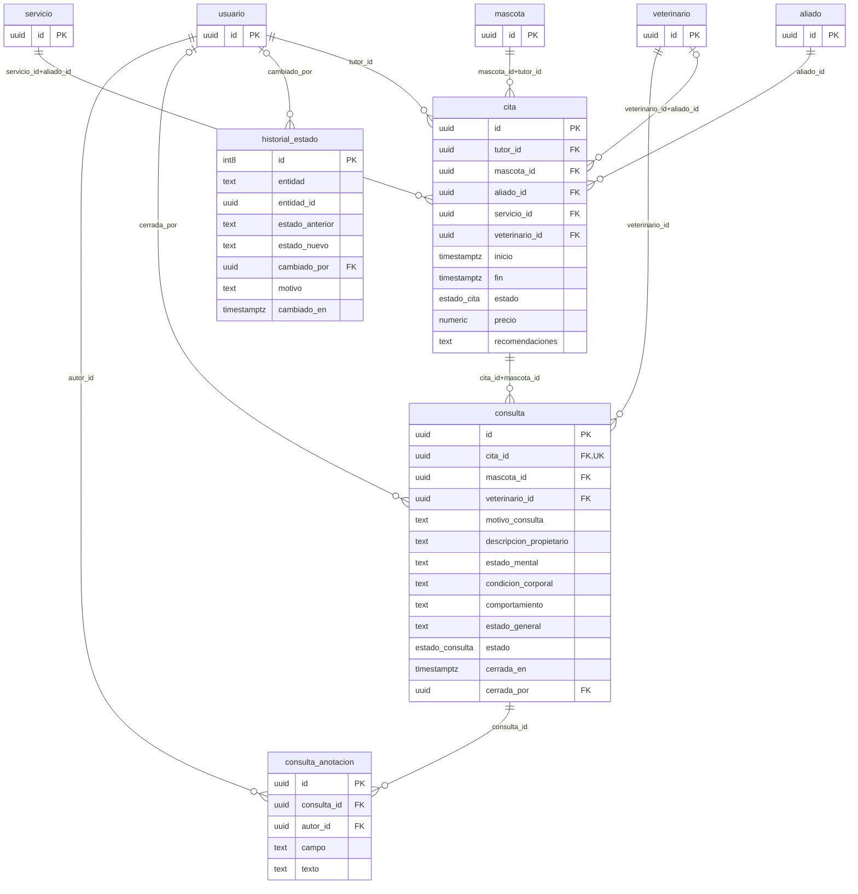
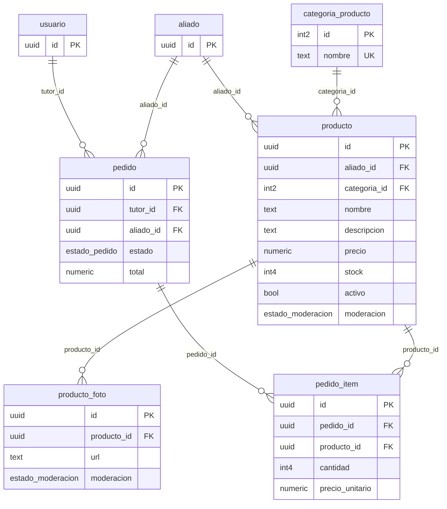
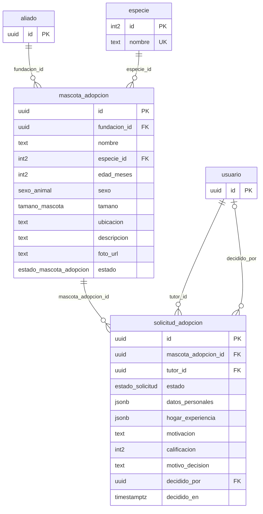
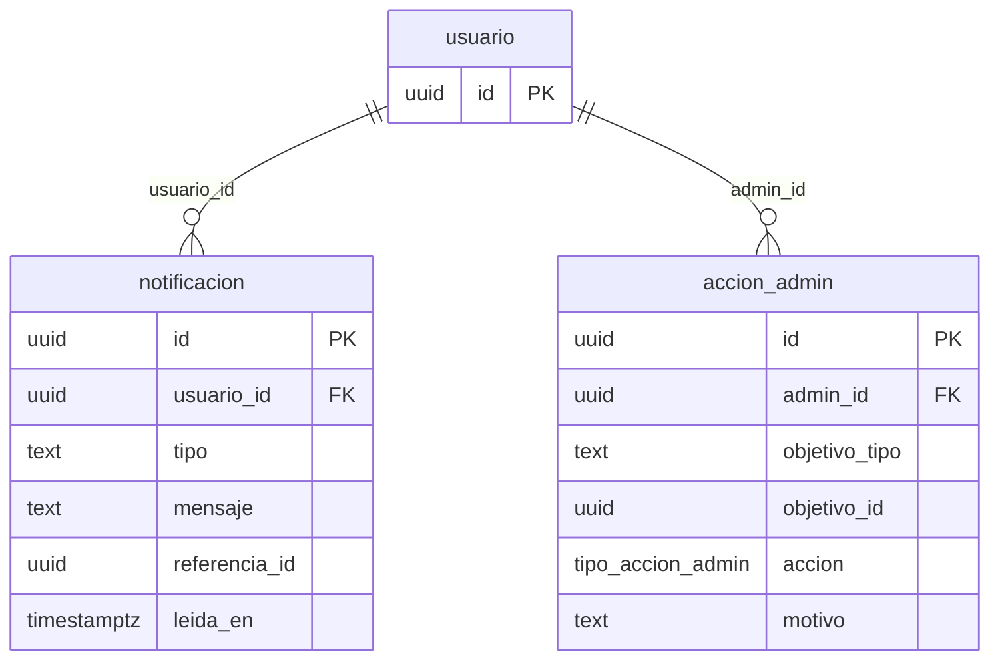

### Vista general (entidades principales, sin columnas)

### 1 · Usuarios, aliados y veterinarios

### 2 · Mascotas, servicios y horarios

### 3 · Citas y registro de consulta

### 4 · Productos y pedidos

### 5 · Adopción

### 6 · Notificaciones y administración

